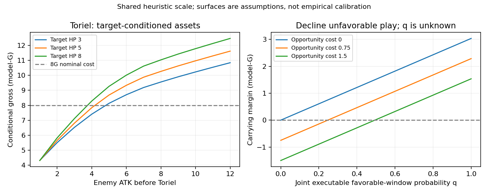

# 条件绝对数值、出手机会成本与用途

日期：2026-10-20。这里是启发式定价标准和可反驳的判断，不是实战校准或无条件强度榜。先由Agent从卡面推导作用、主动找替代候选，再向通用账本提交证据；程序不决定卡牌是否有研究资格。

**新增动作比较口径J见[新潜力卡报告](promising-tactics/REPORT.md)。** 下文原G/N保留共同一张焦点牌承诺的基线；当比较单卡/多卡/不出等不同库存动作时，新增账本另扣所有实际打出/Erase的手牌，记录生成后打出的抵消，避免把额外准备牌当免费。J只用于同根、同阶段的条件动作差，不能直接替换下文携带公式中的N：F与手牌价格尚未联合校准，裸体Aaron可能有负J，瞬时pass没有计入后续被压制代价。查询拒绝两口径直接混比、拒绝对J直接套max(0,J)。新反例也要求先检查现有敌场致死等用途约束，再比较资产分；不改旧验证结论来迎合新结果。

## 共同尺度与账本

保留已有BodyScale参照F，**F(6,5)=5模型G**。它不是由本轮表现拟合的新权重，不因卡名调整。中央展示价：面伤/实际英雄治疗p=.25、有效额外牌ρ=1、金币λ=1；同时提供p∈[.15,.4]、ρ∈[0,2]、λ∈[.5,1]及身体尺度角点。它们都是公开假设，区间不是统计置信区间。

条件毛价值：

`G = 友方身体F变化 − 敌方身体F变化 + p×实际英雄HP净变化 + ρ×有效额外牌 + λ×兑现G`

支付后参考余量：`N = G − λ×实际支付G`。因此绝对毛值与费用优势分开，不给便宜卡天然加分。N也不等于真实对局净收益：它没有自动标定死亡、终结、未来窗口、卡位和格子的机会价格。普通消耗一张焦点牌作为共同基准；ρ计额外可用牌，不再重复扣一张常规牌的价格。记录同时显示占格变化与实际付款，额外容量损失应在明确替代方案中比较，不能固定每格扣分。

身体必须按**所选结算时点仍存在的身体**计价。当前Haste互死不能留下原身材；Skate回手不能同时领4/5场面与返还卡；Chest/Lesser已死亡不能把死亡奖励叠在活着的身体上；借牌打出产生身体/伤害后，不能再把同一张牌作为手牌库存计价。未来效果只有在明确的条件路径中兑付，不无条件预领。

每条记录都保存条件、before/after、付款、事件、`valuation_stage`、未定价项。`deployment`、后续主动攻击、own_end、post_Dust、after_Delay不是同一时点；配对工具拒绝跨阶段或不同根状态冒充同场比较。部分已知项之和不是未知整卡的下界——遗漏项可能是负面，例如Normal NPC的麻痹。

## 可选出手与携带

在明确期限和因果出手策略下，q表示**联合可执行好窗口**的概率；从构筑起点须考虑到手/存活/付款/格子/目标，从已经持有开始则不重复乘上手率。它不是边际“出现目标”概率，也不是偷看未来后选最佳窗口的概率。不假设这些事件独立。

`S好=max(0,N好)`、`S后备=max(0,N后备)`，没等到可以不出。

`携带差 = q×S好 + (1−q)×S后备 − H − R`

H为额外持有摩擦，R为替代卡的收益；两者必须不重叠。若H已包含错过替代行动的损失，R设0；不能把同一次丢节奏分别在H、R再罚两次。两者没有数据就保留为参数，不以“高费每回合罚0.2”凑数。

若S好>S后备，打平门槛：`q*=(H+R−S后备)/(S好−S后备)`。这是一个有条件的携带标准，不是模型已经测得真实q，也不是关于实际胜率的保证。身体兑现期限、目标门槛和对手选择仍需单独复核。

## 三个有实际数字的家族

### Toriel：值得出与值得带分开

普通目标ATK=a、HP=h、a≥1：

`G = F(6,a+3) + F(a,h) − F(1,h)`

减少攻击与自身增血共用同一次真实变更，不再另加线性HP奖励。对3/5：G=6.80548，N=-1.19452；对8/8：G=11.03627，N=+3.03627。没有高价值目标时可以保留，不强迫亏8费部署。

若H+R=.75、后备可选择不出，则q*>**24.70%**。H=.75是说明模型的假设，不是测得卡手成本。q=0时携带差=-.75，而不是-8.75；q=.5时约+.768。固定权重的“平均Toriel6.3分”无法表达这个携带条件。

### 同7G：Tsunderplane与Hot Dog Vulkin按目的翻转

从全池主动选出Hot Dog Vulkin作比较，不要求它先进入旧模拟器。以下仅普通目标、当前合法动作、中央参考价：

| 条件 | Plane条件毛值/净费余量 | Hot Dog条件毛值/净费余量 | 机制含义 |
| --- | ---: | ---: | --- |
| 三个尾血：3/1、2/1、1/1 | 8.85578 / +1.85578 | 7.59081 / +.59081 | 群伤清障与3点脸更易兑现 |
| 单个3/5 | 6.61333 / -.38667 | 7.53332 / +.53332 | 单体3伤与较厚身体更有竞争力 |

在**只有这两类机会、H/R相同**的假设下，把不合算部署允许跳过，wide机会占比约需≥**29.66%**，Plane的可选出手收益才不低于Hot Dog。该比例未知，不是天梯构成；其他场面、逼迫回场/保命需求或不同参考价会改变门槛。若错误地强制两者在每个条件都出，会得到约42.1%的另一门槛，足以改变携带建议。这正是为何出手选择不能被平均场景分吞掉。

### 补牌与延期兑现：不能按文字数量固定加分

复用既有同费参照：F(Aaron6/5)=5、F(Bench5/5)=4.684963，故Bench的一次有效补牌价需超过**.315037**，才弥补身体差距。烧毁、无法有效使用时，这个补牌项不能照领。

- Fishing Rod按实际成功的己末窗口与保留下来的可用牌计数；活不下来没有后续抽牌，不设一个无依据的存活概率。
- River Boat的严格Delay后未使用分支没有永久+3牌。另给出明确的4G船＋借来Spider端点：多出Spider身体、实际多付1G，额外手牌计0。
- Lesser Dog另有完整可验证路径：5/5主动换普通5/5互死，实际兑现dG折扣，G=F(5,5)+λd；λ=1时，参考净余量=4.684963+d−6。此路径至少兑2G才为正；这不表示所有Lesser打法都须2G，因为别的路径还可能有先前伤害/交换贡献。单独post_Dust投影已标记未含先前服务，不能拿来给生命周期总分。
- Glyde的h指打出后手牌：F(2+h,2+h)随h变化；不能一面假设7手高身材，一面忽略等6G和占手风险。
- Bloody Tree按实际存活的己方开始次数给成长；Evil Eye的信息、对手弃用受扰牌造成的机会损失仍未定价，不能把每张Spying直接当兑现1G。

## 机会成本的一个低成本确定性部分

手牌7张、连续5次抽1且不出其他牌：保留焦点卡会烧5张，若替代卡已经使用腾一格会烧4张，额外损失为**1张，不是5张**。这只算同一可行抽用路径的库存差；不包含错失场面、替代卡服务或具体被烧卡的质量。H可以很大，但不能把同一格重复收费。

## 其他用途与高费牌

- Papyrus的11G非Program路径限制余额`11≤G<13`；余额足够时Program额外支付2G才获Armor。Charge首击可打脸，杀怪后的追加只打怪。当前链条可定价，未来重复清怪和残余Armor不可悄悄归零。
- Undyne按十次1伤逐步处理。仅没有目标而没发出的次数转Spear；不是Armor挡掉的伤害。空场的7/8＋10/10和清怪后的剩余Spear占用不同格数，均可描述；本轮普通目标集合能清完的并列可折叠，非等价存活并列拒绝冒充最优选择。
- Jevil保留可选武器的条件账本，包括确定单目标的Devilsknife、Spade清障、Diamond可用牌/实际折扣、Heart实际回复、Jevilstail当前群体buff。完整菜单绑定、Club随机施法和未兑现手牌buff仍公开未定价，不能只给裸体7/7或用已知选项之和当总分。
- Taunt/Armor/Dodge的潜力不加固定溢价，另列外部固定伤害包后的存活/剩余身体参考；这不是包含Dust、攻击反伤与对手付费的完整惩罚抗性。

## 验证、覆盖和证据边界

10个新定点检查通过，覆盖可选Toriel、补牌翻转、Haste互死、手牌库存、死亡/回手、Papyrus追加、Undyne、Memorial数量与Boat资源守恒。独立审查实际纠正了Memorial少算自己和Boat双记借牌两处错误；原问题与复核记录均保存。673条保存记录与自身账本/价格相符，只说明数值记账一致，不能证明所有端点符合服务器规则。

全池目录755并不等于755个完成评分；当前49个条件档案是新架构的首批产出，不能凭673条记录宣称准确率。197张旧DeepSeek提取材料保留原状态，本轮0张被自动升级为已验证。真实q、H、替代价值、未知能力和规则裁定继续保留。

新DeepSeek协议以用途、机会和对手规避为中心，服务深卡池遍历；尚无可用凭据，0个新HTTP请求。模型的数值标准仍由主Agent维护，LLM输出只作可审阅的机制与候选资料，不做Gold。

