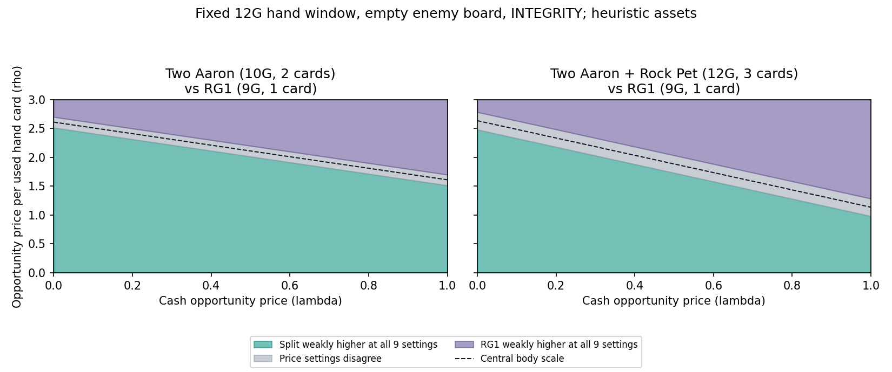

# 12G用于单大怪还是多小怪：已有条件区间

2026-10-20。本轮接续单卡用途研究，已实现自然金币账本、三个局部SOUL被动及多普通敌体的全部攻击顺序。给定同一手牌和用途，程序枚举所有付得起、放得下的组合，而非只评预先挑的两组；交付现金与额外手牌价值的优势区间。组卡仍暂停，身体F保持原式，没有新增卡名分数。

## 开局条件：金币可达、到牌见证与完整对局是不同证据

双方初始1G，未花余额留存。第n个己方回合，先手新增nG，后手在n=1/3/5/7/9再多1G，本轮限n≤10。后手前三回合实际支出`[1,0,0]`时：t1先有3G、花1剩2；t2有4；t3有8；t4有12。Integrity首回合不奖励，后续两回合支出0，因此也恰好12G。回合末新奖励不能用于之前付款。

原始研究给过7张条件手牌。按“起手3张、每己回合包括首回合抽1张”的约定，t4此前打过一张后，只能自然留下6张，原7张不能冒充正常到牌。现从原菜单精确过滤，默认使用：

`[Royal Guard 1, Aaron, Aaron, Rock Pet, Candy Dish, Dummy]`。

到牌见证为：初始`[Dummy, Royal Guard 1, Aaron]`；t1抽Aaron、打出初始Dummy花1G；t2抽Rock Pet，t3抽Candy Dish，t4抽Dummy。总见过7张，当前6张；Aaron与Dummy各两张符合份数限制。另一组只将大怪替换成Mettaton EX。没有同牌无限供应，也没有替方案免费补牌。

投影之所以不必重算战斗，是本支持集没有手数依赖：去掉未使用的Ranger Rudinn只移除含它的菜单，其他菜单的物理状态、费用、SOUL与资产不变；剩手减少一张，最优价格区域重新从保留菜单求出。原7张结果保留为条件研究，不充当自然到牌结果。

**这仍未模拟整个开局。** 首回合正常抽1张是公开约定，原资料没有实测完整首回合流程。初始Dummy如何离场、对手如何形成指定场面、其0余额及上一回合0支出的共同历史均未构造；这里以己场为空的可见根为条件。金币与手牌见证不能证明整个状态由自然对战联合可达，更不能评价攒钱期间被打了多少血、错失了哪些攻击。

## 比较标准与SOUL边界

每个手牌子集最多4张，费用不能超过当前12G。同一组合的Kindness最右增益选择在敌回应前固定；没有在敌不同分支分别挑有利出牌顺序。普通敌怪各可攻击一次，可任选顺序、目标或停手；Taunt消失、Armor每次减伤、Dodge消耗、同时反伤和英雄死亡截止均逐步结算。

先要求所有回应均满足共同HP下限与留体数下限，再在可行菜单中计算：

`V = 最坏回应后的共同资产F及净伤脸价 − λ×(实际付款−已结算Integrity返还) − ρ×出牌张数`。

λ∈[0,1]表示未花金币的外生机会价格；ρ≥0表示每额外用一张手牌的同质机会价格，展示[0,3]。二者均未识别、不是测得的实战值。保留完整剩手和空格数，不能用ρ假装知道每张剩牌的真实长期价值。用途无法保证时数值为空，不以较高资产补偿失败。HP、留体、资产最坏分支的见证分别保存。

| 己方SOUL | 当前已结算部分 | 保留边界 |
| --- | --- | --- |
| INTEGRITY | 记录每回合实际支出；t>1且本回合超过上回合则回合末返1G | 按总实际支出判断，不按牌数发奖励；未到手返还不先花 |
| KINDNESS | t≥3己回合末治疗玩家和受伤友体；无受伤友体时最右+1HP | 本部署研究新体都满血，故主要检验位置增益；将来受伤体需保留最大HP |
| JUSTICE | 己方回合开始对最低HP普通敌体造成1伤 | 不同机制/攻击的并列目标拒绝；完全相同体可取等价代表，不编随机概率 |

`DISABLED_COUNTERFACTUAL`只用于移除被动的诊断，不是第八种SOUL。敌方固定INTEGRITY、前支出0，本窗口不出牌不花钱，回合末不返还；其它敌SOUL明确拒绝。没有敌方抽牌、手牌行动、AOE或回合触发，因此不是完整敌回合安全。

Royal Guard 1为9G7/10，本窗口没有其它友方Royal Guard，其Dust无受益者；截止后的相关价值未知。Mettaton EX为10G6/8，在当前12G及敌现金0条件下，支付后双方均不足10G，清金币Magic不触发；改变余额条件必须重新建模，程序不能把它当一般白板。

## 数量化结果一：额外手牌不能免费

空敌场、共同手牌、至少留1体，INTEGRITY；中心F仍以F(6,5)=5为锚。下表是左方案减单Royal Guard 1的完整差值，单位model-G：

| 左方案 | 实际费用/出牌数 | 中心差值 |
| --- | --- | --- |
| 两Aaron | 10G/2 | `2.612011 − λ − ρ` |
| 两Aaron＋Rock Pet | 12G/3 | `5.273934 − 3λ − 2ρ` |
| Dummy＋Candy Dish＋Rock Pet | 6G/3 | `−0.042389 + 3λ − 2ρ` |

各非空方案在当前Integrity条件都返1G，配对时共同返还相消。便宜方案省下的钱仍保留；没有强迫所有方案花满12G，也没有把多张牌当作一次免费行动。

在λ=.5时，九组共同身体/伤脸压力设置给出的ρ反转门槛为：

| 左方案 | 所有设置左方案不劣的上界 | 所有设置单大怪不劣的下界 |
| --- | ---: | ---: |
| 两Aaron | 2.014110 | 2.201651 |
| 两Aaron＋Rock Pet | 1.730861 | 2.036250 |

例如，两Aaron在ρ<2.014110时于声明设置内严格较高，ρ>2.201651时单大怪严格较高；中间不能给确定排序。两个区间是有限价格压力下的条件结论，不是实际手牌价值估计，也不是连续身体参数的全局界。

图中绿色为左方案在全部九组共同设置下不劣，紫色为单RG1不劣，灰色为设置之间有分歧。完整差平面与浮点多边形保存在`arrival-derived/findings.json`及查询输出，图没有使用实战场景频率。

程序也比较了同一手牌的所有合法菜单。在空敌场、λ=.5、至少留1体时，ρ=1的最优都是两Aaron＋Rock Pet；ρ=2都是两Aaron；ρ=3都是单RG1，分别对九个共同设置成立。这不是子智能体或价格设置投票，而是逐个设置检查同一结论。ρ=0时常偏向花更多牌；这种结果同时暴露可加身体F可能高估宽场的模型缺口，不能把它当铺场已被实战验证。

## 数量化结果二：攻击次数、顺序与SOUL改变用途

己30HP、12G、至少留1体，普通敌10/1只有一次攻击：

| 出牌方案 | 移除己方SOUL被动 | KINDNESS | JUSTICE |
| --- | ---: | ---: | ---: |
| 单RG1 | 留体保证0，失败 | 7/11受10伤仍活，保证1 | 开始先除掉敌体，保证1 |
| 两Aaron | 保证1 | 保证1 | 保证2 |
| RG1＋Dummy | 保证1，HP不损失 | 保证1，HP不损失 | 保证2 |

移除被动时，RG1被10伤杀死并反杀敌体；一次攻击至多杀一只Aaron。Dummy使敌不能打大怪或英雄，但打死Dummy后敌10/1仍在，不能只数友体而抹去敌残体。Kindness给单RG1的+1HP恰好跨过生存阈值；Justice则在部署前移除这只最低HP敌怪。全套结果都使用实际阶段，未给SOUL加固定分。

另一个顺序反例：Ranger3/2 Dodge(1)面对敌1/1和2/4。小怪先打耗Dodge、大怪后打会杀死Ranger；反过来Ranger剩3/1。两条路径敌方均剩2/1。固定敌数组顺序会漏掉不能保证留体的路径；新搜索和独立oracle均覆盖。这个反例使用原始7张条件研究中的卡，默认6张到牌手牌没有Ranger，不会免费补入。

Kindness还影响组合次序：RG1＋Dummy面对敌4/1，Dummy置最右变0/5，至少留2体；若把RG1置最右，Dummy仍0/4，至少只留1体。比较器先选一个出牌次序，再面对全部敌方回应。

## 数量化结果三：纯大/纯小二分仍会漏掉混合解

面对两个普通5/7，要求至少留1体：单RG1和两Aaron均无法保证；RG1＋Candy Dish、两Aaron＋Rock Pet则都可保证。双方都花12G，但前者用2张、后者用3张。中心价格下：

`(RG1＋Candy Dish) − (两Aaron＋Rock Pet) = −1.538493 + ρ`。

费用相同，λ完全相消。ρ大于中心门槛1.538493时，节省一张手牌的混合方案反超；九设置的门槛为`[0.795026,2.001241]`，分歧明显，主要取决于身体与非致命伤脸价格。比如ρ=2时存在设置仍略偏向三体，不能把中心最优推广为稳定排名。

在所有合法菜单中，中心λ=.5、ρ=2时最优为RG1＋Candy Dish，而不是单大怪或预选纯小怪。改用Mettaton EX的另一共同手牌时，同条件最优为两Aaron＋Rock Pet。结论依赖大怪真实身材与机制条件，不能先决定“单大怪流”或“多小怪流”再分配奖励。

## 验证与研究效率

生产源码先提交，再完成4个条件的小批：2个敌场×2个SOUL、中心价格。通过后扩展到原始73个条件、九个共同价格；同一物理窗口的两个留体目标共享物理终点，不重算。原始生产receipt为41个不同物理窗口、2,110个部署变体；这是新增有限问题的计算量，不是评分准确率或独立实战样本。

默认六张版本从原始结果过滤并重求价格区域，73条到牌库存见证及全部保留记录的留手守恒检查通过，没有重算战斗。早期7张结果及图保留，默认入口明确切换，避免掩盖手牌可达性问题。

独立普通战斗oracle采用不同枚举方式：先列攻击者有序子集，再枚举目标，以独立元组代码结算。3,999个小窗口、22,350个完整状态终点与生产搜索一致，另外206个部署变体的子集、位置、SOUL阶段及库存核对一致。它只覆盖至多2敌2友，不是4×4所有状态的形式证明，更不是服务器验证。

新增7项机制检查通过；审查发现自定义输入可传其它敌SOUL却被忽略，已加显式拒绝并仅运行新增1项检查，原正式73条件全部满足护栏，不重算数值。8条默认到牌查询成功；早期读器还实际拒绝非法价格和不可用组合。独立只读多边形核对未发现超界胜出或有限网格覆盖缺口；这验证价格运算一致性，不校准F或ρ。各receipt和未覆盖部分均随Git保存，未请求API、未重跑缺失历史实验。

## 当前能指导什么，仍不能指导什么

当前可回答：给定明确到牌/金币条件和普通敌场，为清楚的HP/留体用途，在共同资源价格假设下哪些部署更好；哪些判断跨越防护阈值；何时因手牌、现金或身体报价未识别而应拒绝总排名。

尚不能回答：攒钱等大怪能否抵偿前几回合失场；真实牌库中抽齐组合的概率；敌手牌AOE/单解的机会；多回合SOUL与生成牌的持续价值；整体实战胜率。额外手牌同质价格ρ和可加F是公开假设。成熟卡组不是这些低成本机制比较的前置，但要估计真实机会分布需要对局或明确的到牌/应对过程，不能用LLM平均估价代替。

下一优先方向是短的、显式到牌序列下“提前铺场”和“保留金币等大体”的同历史比较：让早出怪物在等待期间实际攻击、交换或死亡，保留伤脸轨迹，再检验本轮优势区间是否还成立。不先生成完整卡组，也不以稀罕机制全覆盖或恢复旧大型引擎为前置。
