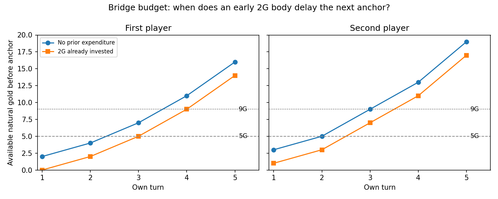

# 通用携带启发：优先费用段、角色与取舍门槛

2026-10-20。这里给出能用于筛选单卡的默认顺序，并将已推导的约束、短序列证据和未验证假设分开。组卡仍暂停，不输出25张牌表、胜率或“最佳费用配比”。

## 当前建议：先保证有效早场，以独立的中费多用途怪物作主体候选

在不知道具体环境、没有稳定额外补牌/减费引擎时，我建议按以下顺序筛选：

1. **先覆盖开局需要的有效行动。** 先手重点找实际≤2G、后手可扩展到≤3G的怪物。优先能形成有效交换、压力或保护的身体；仅仅打得出去不足以计为有效开局牌。2G Rock Pet的3/3是本样本的裸身体基准；Froggit2/3、Moldsmal3/2要由种族/其它用途说明为什么值得替代它。Dummy虽0攻，却可用Taunt保护关键体，属于另一种有效用途。
2. **主体优先考察实际3–6G、能独立站场并兼顾即时作用或续航的怪物。** 这一费用段通常能较早转化金币，同时有空间用一张牌完成有效交换、补牌或控制。候选家族包括4–5G站场兼补牌，以及能立即解除威胁的中费身体。Bench、Chilldrake、Fishing Rod是值得优先比较的续航家族；Vulkin是即时干预家族。必须检查其身体是否跨过需要的攻击/HP阈值，附加效果能否真正用上。
3. **7–12G按明确的单卡密度或回场需求选入。** 可以凭一张牌承担多次交换、节省手牌/格子、修复落后场面或形成终结；不要求每张都带入场Magic。若只比中费多一点无用途身材，又需要额外空过或长期占手，则降低优先级。Knight Knight的重复交换回血、Undyne的清场/召唤属于不同高密度路径，当前短序列没有替它们完成整卡估值。

其中“3–6G主体”是**当前可操作的工作假设**，不是已测出的最优费用段。最可靠的部分是后面的资源、时间和交换阈值；3、6、7这些分界尚未由真实对局验证。不能据此给所有中费加固定分、或给所有高费统一扣分。

## 随构筑约束改变优先级

| 你要解决的问题 | 应提高优先级的范围/角色 | 应降低优先级的特征 |
| --- | --- | --- |
| 经常前两回合没有有效行动 | 能独立工作的2–3G桥接；先手特别检查≤2G | 条件尚未启动的便宜牌、只有后期价值的占手牌 |
| 打算长期争场，额外到牌很少 | 3–6G站场兼续航，或5–9G单牌密度高、可重复交换的单位 | 多张裸小怪才能拼成一个完整行动，且无补牌/循环 |
| 补牌/生成充足、常有空格，能较早结束比赛 | 高效低费、即时威胁、能快速兑现多张手牌的组合 | 为省一张牌而多等数回合，错过攻击/保护窗口 |
| 四格常紧，或多小体难以形成有效交换 | 一张/一格能跨更高交换阈值的中高费 | 低攻小体占格，后续高价值单位无处落地 |
| 需要扭转已落后的场面 | 当回合干预、保护英雄、清除关键威胁的怪物，费用可高 | 只能下回合开始工作的普通厚体，却不能阻止致命打脸 |
| 目标牌只在少数敌场有效 | 有足够替代覆盖、能等到目标的条件型工具 | 只按最佳目标时大赚就常备，未说明无法兑现时占掉什么槽 |

这张表指导的是携带理由。某张牌实际属于哪个费用段，要用**可达实际支付费＋启动负担**：Vine不能永远按印刷12G看，也不能不计先前Plant投入就按3G7/7看。Napstablook的衰减、Tree/Warrior的自伤、Microwave的额外手牌代价也必须先计入。

## 有效开局牌要有覆盖底线

按25张、均匀洗牌、不换牌的条件，若开局已看到s张，其中k张属于你定义的“独立有效开局牌”，至少看到一张的概率是：

`1 − C(25−k,s) / C(25,s)`。

| 有效开局牌张数 | 只看起手3张 | 已看4张（采用首回合再抽1张的约定） |
| --- | ---: | ---: |
| 6 | 57.9% | 69.4% |
| 8 | 70.4% | 81.2% |
| 10 | 80.2% | 89.2% |
| 11 | 84.2% | 92.1% |

若你把“不换牌时80%至少有一张有效早场”设为目标，看到4张时至少需8张有效开局牌；只看3张则至少10张。这里的80%是可选择的设计目标，均匀洗牌是条件，不是环境统计或推荐的完整牌组配比。换牌、特殊起手、首回合抽牌例外尚未建模；需要目标/配合的低费不能不加区分地算进去。

## 桥接是否值得，先看会不会错过主力付款窗口

自然金币留存，因此低费与高费可以互补；但越过付款门槛会有真实延期。

| 无额外收入的主力 | 最早落地 | 在此之前最多净花多少，仍不延期 |
| --- | --- | ---: |
| 先手5G | 己t3，总自然余额7 | 2G |
| 先手9G | 己t4，总自然余额11 | 2G |
| 后手5G | 己t2，总自然余额5 | 0G |
| 后手9G | 己t3，总自然余额9 | 0G |

所以先手t1的2G有效身体，有机会增加早期压力/保护而不推迟第一张5G或9G；后手同样花2G，则会错过上述最早主力窗口，需要用实际早场收益来证明值得。并非所有便宜牌都没有等待成本。卡牌还必须已经到手、有格子、有有效目标；此表只证明金币条件。

两条可执行的自然金币阶梯是：先手2G桥接→t3的5G主体；或先手2G桥接→t4的9G主体。若两者都出，2G＋5G先花7G，9G通常要等到t5，不能同时宣称两张主力都未延后。Integrity奖励也必须根据真实支出顺序结算。

## 为什么长期纯低费需要续航或额外花钱渠道

起手3张、每己回合抽1张，无额外抽牌/生成/重复使用/Program时，到t10最多见13张初始牌。若所有实际支付费都≤c，累计支出至多13c。普通先手t10总自然金币56，因此即使把所有见到的牌全部打出：

| 费用上限 | 至少未花掉的金币 |
| --- | ---: |
| 全≤2G | 30G |
| 全≤3G | 17G |
| 全≤4G | 4G |

这解释了为何长期站场不能只堆“每G身材高”的小怪：到牌速度可能先成为瓶颈。四格、卡手和保留反制牌会进一步降低实际支出。低费仍可能提前赢下比赛，留钱也不是损失本身；这个约束不能用于否定快攻。补牌、生成、Loop、复用和额外支付渠道会改变前提，应重新计算，不能继续沿用表中下界。

## 身材优先区间：用交换阈值筛，避免买无用途数值

普通敌体为(a,h)，己体为(A,H)，一次普通互打后“杀敌且留体”要求：

`A≥h 且 H>a`。

因此若你需要处理4–6HP的单位，优先检查4/5/6攻跨过了哪道击杀线；若需要承受3–5攻后留场，检查HP是否达到4/5/6。这里的压力带是条件，不是已测天梯分布。多一点攻击若只造成过量伤害，不一定比多一点跨生存线的HP更有竞争力。

例如Aaron6/5与Bench5/5同为5G：敌6HP时前者多1攻可能少花一次行动清除；若敌HP≤5且额外补牌有用，Bench才更容易兑现其资源优势。低攻厚血可以保护身体数量，但没有Taunt/即时干预时不能自动保护英雄。Dodge、Armor、Kindness的阈值要按真实伤害实例和次数处理，不能固定换成若干HP。

## 本轮怎样挑战这些建议

新增短序列从双方空场、30HP、1G开始，使用同一真实到牌前缀和自然收入。部署计划固定，普通攻击顺序、目标和停手做MAX/MIN搜索；双方必须支付金币，已出怪会实际攻击、交换、死亡，Kindness处理伤体/位置，Bench从同一牌序抽取下一张。期限分别到双方己t4/t5，避免只看落地静态资产。

初始设计把后手5G/9G也固定到t3/t4，独立审查指出这样隐藏了更早落地机会。现已单独补入后手t2的5G和t3的9G，对旧结果不重算、不覆写。查询桥接问题会自动选正确的更早对照。补牌也加了“抽到的牌真实提前出场”的计划，而非只给终点多一张手牌。

这些是对携带准则的机制证据，不是自由选牌的最优开局。固定部署有意限制策略；对手脚本和未来到牌公开，会产生完美信息优势。截止总在全局后手回合末，后手刚下的身体尚未受下一先手回合回应，不能把先后手结果平均成客观强度。主力额外机制和真实环境频率依然未知。

还发现必须先检查保血用途：一组后手Kindness压力对照中，9G厚体赢资产报价，但只能保证截止15HP；若用途要求至少20HP，则它不合格，而2G桥接＋5G可保证。高费携带的单卡密度不能补偿用途失败，见[短序列报告](REPORT.md)与`safety-probe.json`。15/20只是本次显式探针，不是已测安全血线。

## 建议的可靠性

- **解析约束较强：** 金币付款门槛、手牌到达上界、份数与四格限制、声明普通交换阈值，以及条件洗牌概率。
- **有限模型内可复核：** 同一到牌/对手部署下的普通战斗、延迟、补牌加速与溢出反例。身体F、非致命伤脸价和剩余手牌同质价格仍未校准。
- **当前启发式建议：** 先满足有效早场，再优先实际3–6G的独立站场/即时作用/续航主体；按单卡密度、回场或终结需求提高特定高费的优先级。具体分界和配比仍可被反例推翻。

当前不需要成熟卡组才能继续比较这些机制。要把建议升级为真实环境的最优费用配比，还需要有效开局牌的定义、比赛持续时间、敌手牌惩罚、额外到牌与机会过程的证据，不能用若干场景均值或LLM报价替代。
