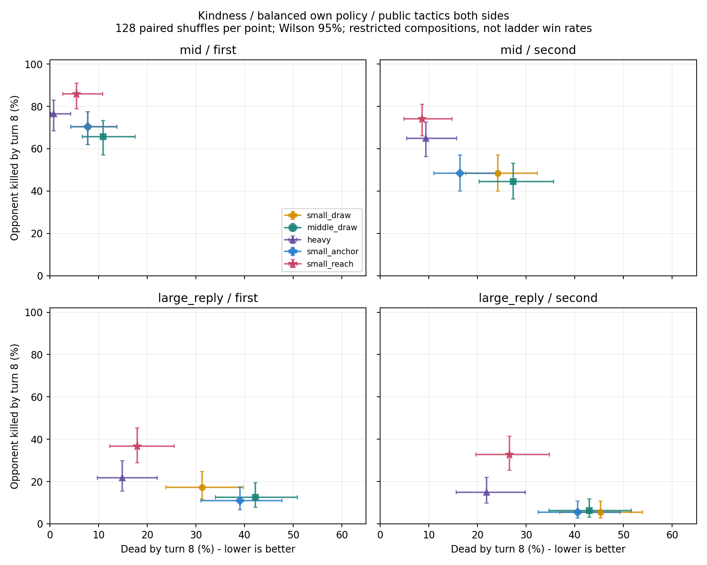

# 前期携带与打法：先保证兑现路径，再决定费用

**本轮撤销“实际3–6G作主体”的普遍默认。** 更有证据的优先顺序是：保留足够的有效早期行动，再补当前结构缺少的破场、收尾或抗压用途。中费、高费是否值得携带，应看它们替换现有牌后，实际改善什么目标，并承担多少开局/等待风险。

当前工具已经把25张组成、随机上手、金币留存、自由部署、战斗、四格、七手、实际回复和补牌连接起来。它模拟15种真实卡的受限开局，**不搜索推荐完整卡组，也不输出实战胜率**。下面数字都是指定组成、策略和洗牌假设下，至双方己t8的事件频率。每格128个配对洗牌，Kindness己方、分座次；换牌、神器与首回合流程尚未完整核实。

## 一个可以优先采取的携带改进

在已有较多2–3G单位和Fishing Rod续航的实验结构中，**优先测试减少弱小占格体，补能直接影响当前场面/生命的6–7G单位；不要先继续增加弱体或仅增加抽牌。**

本次把3张Tiny Froggit换成2张Tsunderplane＋1张Sad Dragon，记为`small_reach`；其余22实体及洗牌位置不变，基线为`small_draw`。该改动同时改变身材、费用、Haste、入场伤害与防御，不能归因“7G更强”，也没有验证这三张的最佳张数或Sad是否必要。

下表双方都使用修正后的公开出牌次序。数值为 **8回合内击杀 / 自身死亡**；未结束的样本仍纳入分母。

| 对手及座次 | 原小单位＋Rod | Tiny3→Bench3 | Tiny3→Plane2＋Sad1 |
| --- | ---: | ---: | ---: |
| 中费、交换策略，先手 | 70.3% / 7.8% | 70.3% / 7.8% | **85.9% / 5.5%** |
| 中费、交换策略，后手 | 48.4% / 24.2% | 48.4% / 16.4% | **74.2% / 8.6%** |
| 大体、交换策略，先手 | 17.2% / 31.3% | 10.9% / 39.1% | **36.7% / 18.0%** |
| 大体、交换策略，后手 | 5.5% / 45.3% | 5.5% / 40.6% | **32.8% / 26.6%** |

reach包的四格配对击杀差分别为 **+15.6、+25.8、+19.5、+27.3个百分点**，探索性95%配对区间均高于0。随后只增加四格“同一对手改为偏打脸”的挑战，击杀仍提高 **+3.9、+16.4、+12.5、+19.5个百分点**，对应区间也均高于0。这是受限世界中的跨策略支持，不是外部留出对局验证。

代价真实存在：先手首回合没有可出怪由2/128升至6/128；无换牌均匀洗牌的解析概率由 **1.66%升至5.65%**。对大体交换对手，先手t4平均敌HP原结构20.60、reach21.66，后者最早一段压力还略低；但t8击杀更高。**牺牲一些第一拍覆盖，可以换来更强的后续兑现，不能只按开局出牌率排名。**

Bench替换确实增加补牌、减少阻塞，却没有同样的击杀改善，对大体先手还变差。故“缺小体质量→补中费”“缺续航→直接堆抽牌”均不是充分理由。

## 如何判断小单位进攻是否能接受风险

先指定期限与用途，再比较完整样本，不能只看抽到小怪时有多强。

1. **没抽到的后果。** 分开“首次决策无可出怪”和“有怪但选择不出”。前者不应固定扣一个费用值：重体结构先手68/128无首回合怪，对交换型中费对手仍可借后续大体/嘲讽回场；换成偏打脸的对手，失去早场的风险就增加。条件样本与分母见冻结结果，不能把这些条件比例当抽牌的因果效应。
2. **压力是否跨过回复和阻挡。** 不用累计打脸代替压制。一个完整见证中小体实际打脸27，对手回复4、最终仍有7HP，自己先死。仅关闭对手英雄回复的同牌序反事实，原小体＋Rod对大体的击杀增加24.2/23.4个百分点（先/后手，旧v0.2固定策略）。这是回复改变收尾阈值的证据，不能直接移用为新策略的增幅。
3. **能否把格子变成下一轮有效行动。** 满场并非自动失败；只有手中有当前付得起的有效替代体被挡住才记阻塞。reach对大体两格“至少一次回合末受阻”从85.2/85.2%降至53.1/57.8%，同时改善击杀。Bench也降低阻塞却不普遍改善结果，说明阻塞只是诊断，不能单独当强度分。
4. **抽牌是否真的被花出去。** 统计额外抽到、实际打出、留手、烧毁和疲劳。双方每次自然多抽1张，某些小体/中体组平均增加约5–7张烧牌，结果未一致改善；把手限放宽到10也没有自动解决进攻兑现。手限、金币、格子和单位密度要一起看。

## 不同目的下怎样选

在大体交换对手、先手、同一截止t8下：

- 若要求“自身死亡率上限25%”，并用样本的边际95% Wilson上界做保守筛选，五个候选中只有`heavy`通过。它的击杀21.9%、死亡14.8%；reach的死亡上界略超过25%。
- 若改为“击杀至少25%、死亡上限35%”，同样用上下界筛选，则只有`small_reach`通过。

这些阈值是使用者的目标示例，不是已测安全标准。Wilson只覆盖本世界随机洗牌误差，既非多条件同时保证，也不覆盖策略偏差。工具还支持t1–t8、打到15HP或己方保留15HP的目的；读取已存半回合轨迹，不重跑对局。

**费用上的实际启发：** 2–3G独立桥接仍值得先保证；增加3–6G数量本身不构成质量提升；当已有早场却经常收不了尾时，优先考虑有即时破场/补刀用途的中高费，而不是继续追求更低费用或更多抽牌。7–9G大体的耐久/嘲讽可用于抗压，但不能把所有高费都视为同一种回场手段。本次reach与heavy存在进攻/生存取舍，没有通吃的费用带。

## 查结果

在仓库根目录运行，命令均只读保存结果：

```sh
python analysis/card-comparison/2026-10-20/joint-opening/prioritize.py --opponent large_reply --seat first --max-death .25 --conservative
python analysis/card-comparison/2026-10-20/joint-opening/prioritize.py --opponent large_reply --seat first --min-objective .25 --max-death .35 --conservative
python analysis/card-comparison/2026-10-20/joint-opening/query.py --stage extension --composition small_reach --compare-stage tactics --compare-composition small_draw --intervention public_tactics --seat second --metrics killed dead first_turn_no_opener
```

[完整报告](REPORT.md)、[实验协议](PROTOCOL.md)、[程序及证据入口](README.md)、[相同洗牌的成败动作见证](witnesses/index.json)。


