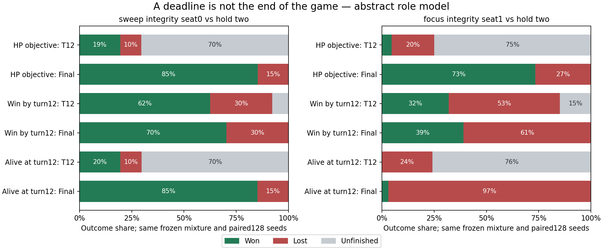

# 从完整演化检验策略：当前收益、截止存活与最终获胜不是同一目标

2026-10-21。试验于20日启动，方法依据仓库[整体研究原则](../../../RESEARCH_PRINCIPLES.md)。本轮实际连接了随机开局、资源消耗、隐藏且付费的惩罚、对手保留时机以及受罚后的继续对局，并依据结果修改了评价方法。没有以新增单卡档案作为主要进度。

**当前最有用的结论：** 当目标是最终取胜时，评价卡牌和构成，应观察它使哪些可执行策略更能最终取胜；早期输出、截止生命、存活或再部署能力分别是过程信息。它们也可以是明确期限任务的合法目标，但不能固定成通用强度代理。这个认识在旧理论中已有，本轮新增的是运行证据、可重放反例与一次实际方法修订。

## 研究对象与证据边界

这是机制角色模型，不是真实卡组对战工具或全卡池强度榜。角色包括普通小/厚身体、补牌、回复与付费惩罚，参数可改；牌序无放回随机，双方从30HP/1G/起手三张开始，传播自然收入、金币留存、手7格4、召唤失调、攻击/交换、SOUL、烧牌和疲劳。玩家能留资源、等待或投入；惩罚只有在手且付得起才可用。政策看不到敌手/牌序。

四种角色分布与声明的因果政策构成有限策略池。对手可立即使用、保留至更高回报，额外政策还改变攻防或允许先削血再攻击。矩阵求解只在这个池中成立。A按照公开现金/未见消耗提防，是启发式，不是选择性保留后的真实后验；已知对手回应总数、烧牌身份公开也是抽象假设。

2/2与5/7恰好处在3伤两侧，是参数预设，**不能把厚体选中当成高费更强的发现**。未覆盖Haste/Charge、即时面伤、沉默/变形和真实终结组件等重要常见机制，故本轮不推荐现实费用带或完整卡组。

## 一、对手何时用惩罚，确实能改变策略价值

使用相同组成与初始实体排列，仅改变对手的回应条件，冻结在训练牌序选择的我方策略，再在独立牌序评价。在单体Kill的四个主要世界，保留至更高HP目标使原推荐的期限双方生命差下降约 **10.47～13.70HP**，逐世界配对区间不含0；不是给卡面额外扣一个人工风险分。

群伤部分的证据弱一些。例如INTEGRITY先手下降2.05HP，但关闭首次抽牌后，变化反向且区间跨0。**不能外推出“任何惩罚都必须等多杀”**。完整配对结果在[原试验摘要](experiment-v01/derived/summary.json)，区间只反映该世界的洗牌误差，未覆盖模型错误或多重探索。

更大行为池还改变攻击策略。在公开零回应的控制世界，这种行为变化仍能造成0.3805的标准化生命差损失。因此其全部效果不能归因于“有意识保留惩罚”。报告把干净的时机对照与更大行为挑战分开，没有用更大损失美化时机结论。

提防也有代价。例：同anchor结构、群伤/INTEGRITY先手、等二杀对手，commit和guard_two的期限生命差分别0.1646与0.0596；实际赢16.41%与8.59%。单纯少铺场、留一张怪并未更好。bank还同时改变身体选择，不能把其结果全归因于存金币。**抗惩罚应体现为投入、承压、后续施压与恢复的策略链，不能固定为保守加分。**

## 二、生命差代理暴露了目标问题

同一群伤/INTEGRITY先手、anchor结构、等二杀对手：

| 原评价集中的策略 | 12回合内赢 | 输 | 尚未结束 | 截止生命差/30 |
|---|---:|---:|---:|---:|
| commit | 16.41% | 7.03% | 76.56% | **0.1646** |
| pressure_commit | **68.75%** | 27.34% | 3.91% | 0.1164 |

生命差确实选择了更少死亡、更多未决的路线，不能据此声称它总体更强；也不能直接宣布击杀更多的路线更强，因为两者仍有不同失败风险和未知尾程。八个主要世界在8回合的原任务选择都偏wide，到12回合有七个改选其他结构，说明任意截止显著影响结构建议。

方法因此实际改变：保留原生命差结果作为明确任务的诊断，**不再默认用它排序通用竞争力**。查询默认展示完整剖面；要排序必须明确截止击杀、存活等目的。最终胜率未知时给完成区间，不把未决当半胜或用F/J补造赢家。

## 三、用全新牌序检验目标修订，再继续到模型内终局

旧评价集启发了上述问题，因此不能再把它当新结论的独立验证。只用旧训练牌序，分别按生命差、截止实际击杀、截止未死拟合三个混合；程序与混合先提交，然后使用从未参与选择的30000段128个牌序。三者在相同牌序、相同对手列上比较全部胜/负/未决。

之后没有更换策略或补造叶节点价值，而是恢复这批轨迹的完整状态，核对全部9984个已保存前缀，再原样继续。最终全部按抽象规则到达HP终局，最迟第30轮；没有将它们算作9984个额外独立样本。共有636条记录以疲劳结束，其余以攻击结束。政策仍是声明池中的有限启发式。

下表固定为群伤/INTEGRITY先手、等二杀对手，都是新牌序下、事先冻结混合的事件率：

| 训练时追求的目标 | 12回合前赢 | 12回合前输 | 未决 | 原策略继续后的最终赢 |
|---|---:|---:|---:|---:|
| 期限生命差 | 19.48% | 10.13% | 70.40% | **85.22%** |
| 截止实际击杀 | **62.50%** | 29.69% | 7.81% | 70.31% |
| 截止未死 | 19.53% | 10.16% | 70.31% | 85.16% |

“赢得更早”在此确实牺牲了一部分最终获胜；提前击杀与最终取胜的差异不能用一个固定血量价换算。截止击杀混合相对生命差混合，最终赢少14.91个百分点，配对探索性95%区间约[-23.60,-6.23]个百分点。

反过来，在单体Kill/INTEGRITY先手、同一保留列，三种混合最终赢分别 **37.50%、68.75%、88.28%**；在后手对应世界则为 **73.44%、39.06%、3.12%**。这些混合的角色/打法本来就不同，不能把差异说成SOUL/座次的单一因果效应，也不能说生命差或生存永远好/坏。它们说明：**评价目标、可行策略、资源演化和反制相互作用，默认代理不具通用性。**

[新目标全部结果](objective-validation-v01/summary.json)、[继续至终局的全部结果](objective-validation-v01/continuation/summary.json)、[图表数值](objective-validation-v01/figures/figure-data.csv)。胜率仅指该抽象世界及政策，不能当真实Undercards胜率。为便于阅读上表展示一个固定回应列，文件保留全部三个列，没有按新评价结果挑最有利对手。

## 四、未知继续价值要保留为未知，并选择性缩小

在继续尚未完成时，对每个冻结前缀可先用`已赢 ≤ 最终赢 ≤ 1−已输`给外包络；再用每世界同时95%的二项率界区分抽样误差。它不指定未来行动，也不是完整游戏最优值。

原八个主世界，只保留未知继续结果、不加抽样盒时，各自还有13～23个纯策略未被充分排除；加上有限样本的同时置信盒后，各世界均保留24个。**不能把后者全归咎于截断，也不表示24个策略等价或都最优。** 这只是当前证据不足以安全排除。上述9984条继续对局针对冻结支持策略缩小了其中一部分未知，并没有替整个原池补齐后续，更没有补齐真实游戏。

恢复率也不是替代总分。原时机池选中策略的“有足够观察窗口、被首次有效惩罚后两回合内再部署”条件率约97%～100%，但仍可能大量输。只是能再出一个怪，并不能证明已恢复足以施压、保护或收尾的策略。

## 五、当前数值模型怎样组织

已有逐卡条件账本继续用于核对机制与即时资源变化。整体层应把这些变化放回因果对局中，评价持有某卡/结构相对替代物，改变了哪些最终结果、风险和可行路线；不能把局部毛值直接平均成构筑强度。

本轮工具已经能比较声明机制域内从开局至终局的随机策略结果；能将未决与已发生结果分开；能暴露固定对手、代理目标与期限导致的错误建议。**它还不是可对真实全池直接给出可靠通用榜的模型。** 全局卡牌评价、现实机会分布、完整反制策略与常见机制映射仍未验证。

接续选择应依据现在的主要不确定性：原策略池只会少数固定攻防/保留规则，真实卡牌又有重要即时干预与终结方式。后续应优先检验阶段角色转换和这些常见机制能否改变“继续后赢”的判断，再决定如何扩大卡池或改善信息更新。不能仅加大牌序数量，或将本轮选中的角色分布写成永久费用建议。这里记录的是选择理由，允许新证据改变路线。

## 保存与检查

新主试验保留322560条种子级角色轨迹（共享牌序，不是同数量独立样本）；新目标验证9984条，继续沿用同一批轨迹。统计单位按同世界的独立牌序处理。原开局/缺失历史实验均未重跑，新API请求0。

12个新模型检查、4个新完成界检查通过；另有独立有限矩阵数值检查。正式前修复了互死HP判断和Integrity后续收入预测，原失败探针完整保留。只读审计检查了15360个无威胁政策对和23040个期限前缀，均完全一致；继续对局的9984个原前缀也一致。检查的范围和不证明什么见[verification.json](verification.json)。

全部源码、协议、训练选择、原始压缩记录、反例、独立审阅和继续结果随Git保存。约10MB的原始记录已经推送，其他新结果也按仓库交付标准提交推送；不依赖本地未上传轨迹。
