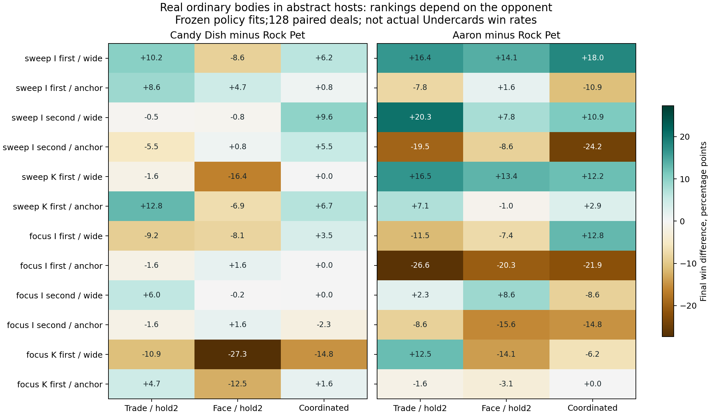

# 从“不要怎么打分”推进到可检验的身体与打法选择

2026-10-30。承接[上一批终局研究](../2026-10-20/REPORT.md)，本轮给出正向、可比较的条件建议，并保留它们失败的位置。**最明确的结果是：当前结构缺少什么，会改变应补哪种身体；身体价值又取决于可执行的打法。** 这些是指定角色环境中的证据，尚不是实战全环境卡牌榜。

## 已能给出的条件建议

以下都比较三张同名候选替换相同的三张small槽位；包含未上手、未打出、被惩罚与失败，不筛选成功兑现。其余host和对手规则保持一致，初始实体排列配对。wide原为15小体/4厚体，anchor原为9小体/10厚体，另有相同数量的补牌、回复与回应；替换后分别剩12或6个原小体角色。**它们是角色背景，不是现实合法卡组。**

**小体背景、3伤群攻、INTEGRITY先手：优先检验Aaron补充单格高攻击，而不是继续增加Rock Pet这一档。** 两者都在训练中选中同一`frontier_race`，所以此处没有靠换成不同政策制造胜负差：

| 三槽候选 | 对手交易/等二杀 | 对手打脸/等二杀 | 对手也会协调攻击 |
|---|---:|---:|---:|
| Rock Pet：2G3/3 | 53.91% | 35.16% | 37.50% |
| Aaron：5G6/5 | **70.31%** | **49.22%** | **55.47%** |
| Aaron相对差，百分点 | +16.41 | +14.06 | +17.97 |
| 探索性配对95%区间，百分点 | [8.05,24.76] | [5.72,22.41] | [8.63,27.30] |

这不是“贵就好”。相同群伤条件的anchor背景，适配后Aaron对Rock Pet分别为−7.81、+1.56、−10.94个百分点；在INTEGRITY后手anchor背景三列均下降。**已有厚体主力时，应转而检验便宜衔接/辅助身体，而非把上一结构的高攻击补位原样搬过来。** 不过anchor中两者选中的政策不同；第三列固定greedy时差为0、仅协调攻击时为−0.78，不能把适配后的−10.94全归为构成或身体的单一因果效应。对打脸列，两个固定政策下Aaron仍分别低14.84、11.72个百分点，支持存在明确的条件风险。

**需要施压时，不因血量厚就优先Candy Dish。** 在单体Kill、KINDNESS先手、wide背景，两者都选同一`frontier_race`：

| 三槽候选 | 交易/等二杀 | 打脸/等二杀 | 协调对手 |
|---|---:|---:|---:|
| Rock Pet：2G3/3 | **69.53%** | **63.28%** | **72.66%** |
| Candy Dish：3G2/6 | 58.59% | 35.94% | 57.81% |
| Candy Dish相对差，百分点 | −10.94 | −27.34 | −14.84 |

三个探索性区间均在0以下。它的血量虽能跨过3伤群攻阈值，但本条件的回应是单体Kill；这份潜在抗性未自动补偿当前攻击/付款差异。它在其他背景又有用途：群伤、INTEGRITY先手的anchor中，Candy Dish被训练选中；新评价三列为98.44%、77.34%、97.66%。这支持按角色缺口选择身体，**不支持给“厚血”统一加分或判废Candy Dish**。

图中所有格子都是模型内终局事件率之差，没有按环境频率加权；小差异不应硬排。完整数值和区间见[比较表](experiment-v01/comparison.csv)，图表数据见[figure-data.csv](experiment-v01/figure-data.csv)。

## 机会成本进入了什么，尚未证明什么

本轮从随机起手开始，实际支付金币、保留资金、占用手牌/格子，打出后才有召唤失调与战斗。携带替换造成的完整胜负差已经包括这条演化里的机会代价，**不再另外猜一个固定“卡手扣分”加上去**。诊断只解释路径，不是把若干重叠计数相加。

在上述群伤/INTEGRITY先手/wide、协调对手条件，三张候选的整局分母为：

| 候选 | 始终没收到候选 | 收到但一张也没打出 | 至少打出一张 | 首次出场均值，限出过场 |
|---|---:|---:|---:|---:|
| Rock Pet | 3.91% | 1.56% | 94.53% | 己t4.08 |
| Candy Dish | 3.91% | 3.12% | 92.97% | 己t5.66 |
| Aaron | 3.91% | 3.12% | 92.97% | 己t6.20 |

这里“收到”排除被烧掉的抽取；一局有三张候选，不能把至少出过一张当单卡出场率。首出时间是条件均值，受整局结束、抽牌和打法影响，不是费用单独造成的因果延迟。Aaron兑现更迟仍可能提高整体赢率，是比“高费卡卡手”更有用的判断；也不表示其等待免费。全部候选的互斥分母和其他诊断见[opportunity.json](experiment-v01/opportunity.json)。

共同决策量现在是：在声明背景与对手规则下，替换卡牌后允许合法策略适配，改变了多少终局获胜、何时出场、哪些路径失败。原逐卡账本仍解释即时资产变化，不能把它与此处事件率混成一个通用总分。真实环境分布未知，绝对携带价值仍不能凭这些条件平均补造。

## 数值反事实：付款、身体阈值与策略适配要分开

三种虚构卡面都明确标记为参数反事实，不当作真实卡池。在群伤/INTEGRITY先手/wide、协调对手条件：

- Aaron由5G改为2G、攻血仍6/5，两者政策均为`frontier_race`，终局赢率55.47%→75.00%，差+19.53个百分点，区间[11.98,27.08]。这说明原胜率已经承担了显著付款/兑现限制，不能只用出场后6/5估携带。
- Rock Pet由3HP改4HP、其余相同，两者同为`frontier_race`，37.50%→50.78%，差+13.28个百分点，区间[6.28,20.28]。这里跨过3伤群攻确有收益，不能将+1HP固定成跨背景相同的价格。
- Candy Dish由3G改2G，适配后43.75%→50.98%。但它的政策混合也改变，故这不是固定打法下纯降费效果；另存[固定策略规则比较](experiment-v01/fixed-policy-comparisons.json)，不将两种含义混用。

反例也完整保留。便宜Candy在同world的交易列下降12.30个百分点，实际由原纯race变成race/entry混合；相同race下该列两者都赢64.06%，而混合的三列最低结果26.56%→42.09%。4HP Rock在群伤/INTEGRITY后手/anchor的某列下降14.84个百分点，也伴随政策切换；对应固定greedy/仅攻击规则反而改善，适配后的三列最低结果还略升。**单列下降不能直接解释成降费或加血本身有负价值，也不能把针对最差列选择的混合要求为每列都提升。** 另有固定政策下的负变化，原因尚未用动作轨迹识别，保持未决，不调公式抹平。

其中一个可核对的策略交互是：单体Kill的等二杀政策实际门槛为目标HP≥4；3HP改4HP既改变承伤，也可能让对手更早愿意花Kill。在单体Kill/KINDNESS先手/wide的打脸列，固定attack_frontier下4HP版本赢55/128，3HP赢63/128。门槛机制与这个方向相容，但当前记录不足以把八局净差逐一归因为该机制。加血价值必须同时考虑相邻阈值与对手策略，不能只核对群伤存活。

## 攻击能力修复，不等于端点偏好已经可靠

旧规则不会主动用第一次无法击杀的攻击，为第二次补刀创造条件。独立手算反例中，两个2/2可以合力解掉致死5/4；旧策略却全部打脸后输。本轮前沿允许所有这样的顺序、合法面伤与当前已持有且付得起的一次回应组合。精确的是这段可达性，**决定非终结端点的偏好仍是启发式**。

只替换攻击、不改原回应门槛的消融，有真实改善也有失败：单体Kill/INTEGRITY先手/wide/Moldsmal对打脸对手，原规则赢18.75%、仅协调攻击63.28%；但单体Kill/INTEGRITY后手/anchor/Aaron对协调对手，原规则79.69%、仅协调攻击60.94%。后者差−18.75个百分点，区间[−27.65,−9.85]。所以“能找到安全解场”不能直接升格为“应该总按该端点规则选择”。

其余政策分别联合规划回应、优先脸伤、优先厚体或为已持有的高攻击身体存钱一回合。选择以模型内最终赢率训练，并让对手也得到协调能力；没有用生命差代理替代赢家。训练最终主要使用race、durable、entry，并未证明场上攻击差优先是好默认。

有限池适配本身有正向证据：60个实卡×host×条件中，冻结混合在新评价集的**三列观测最低赢率**均高于原greedy的三列最低值。它仍可能在某一列下降，正是需要区分对手已知与对手未知任务的原因。这个最小值是描述性统计，不是60项同时显著或全策略保证；不能由此抹去仅攻击规则的失败。

当前仅攻击压力约束未计尚可打出的回复、公开疲劳历史及真实隐藏即时伤害；Kindness单位治疗/增血也未进入端点排序。它们不影响引擎继续计算实际结果，但可能使策略选错。以上失败暴露了**策略选择的可靠性缺口**，不能算在卡牌身上。

## 训练建议也会失败，不能事后改名为验证成功

48个新训练牌序用于选择有限政策混合；128个全新牌序只用于评价。五张实卡中按训练maximin最高挑候选的分析，是评价运行时、尚未读取评价胜负前追加的，选择已先提交；**不倒称为原始预注册问题**。[body-selection.json](experiment-v01/body-selection.json)保存原选择，[body-recommendations.json](experiment-v01/body-recommendations.json)保存后来评价。

12种host/条件中的训练选择包括Aaron、Candy Dish、Rock Pet，以及一次Moldsmal与Rock Pet训练并列。它不是新评价中的最优榜。例如单体Kill/INTEGRITY先手/wide训练选Candy Dish，评价三列最低50.78%；未被选中的Rock Pet为59.93%。不能事后改选Rock再说建议通过独立验证。单体Kill/KINDNESS先手/anchor训练并列时按既定顺序选Moldsmal，后来的描述性最低82.81%，Rock Pet为85.16%，也不能据此断言Moldsmal更强。

最差列只是这三个声明对手的观测最小值，不是全策略保证。没有真实环境权重，不把12种条件平均成现实总分，也不将训练数值证书当总体可信区间。区间均为逐条件探索性配对正态近似，不覆盖模型误差、多重探索或未实现机制。

## 保存、可信度与下一选择依据

新工具支持任意声明费用/攻血的普通身体插槽；这次真实映射严格只有Froggit、Moldsmal、Rock Pet、Candy Dish、Aaron。没有把其他卡删除能力凑数。候选实际费用、攻血、满格和受伤阈值都参与策略与转移；三槽同名数合法不意味着其余host合法。固定最低UID槽位使同费部署破同分偏向候选，属于当前公开政策，不是任意出牌优先级的保证。

本轮保存93312训练、132480评价记录，共用48+128个牌序对；不是同数量独立样本。全部达到模型内HP终局。10项新定点检查通过；独立复核的54组模式重放/118计划及12组穷举对照/81数值端点通过，源码与输出保存。训练选择、评价原始压缩记录、负结果和[只读检查收据](verification.json)均在Git。旧正式实验未重跑，新API请求0。DeepSeek运行凭据仍skipped；没有以LLM评分代替这些结果。复核见[方法结果审阅](methods-results-review.md)与[结果挑战](results-challenge.md)。

这比上一批只排除代理目标前进了一步：已经能给出普通身体的条件补位建议，并以完整兑现代价、相同打法和独立牌序检验。**尚不能推荐真实费用核心、完整卡组或声称指导全池实战的可靠度已达标。** 接续应优先处理已暴露的端点偏好/等待策略不足，并将会改变施压与终结的常见真实机制接入；不能只加牌序、扩白板清单或要求所有局部数值都单调。选择应继续由这些不确定性是否改变正向建议来决定。

用户提出每2小时自动续作；执行内容与真实阻塞见[RESEARCH_AUTOMATION.md](../../../RESEARCH_AUTOMATION.md)。当前无平台调度接口，**未建立定时任务**，本报告与Git保存不等于已启动后台Agent。
